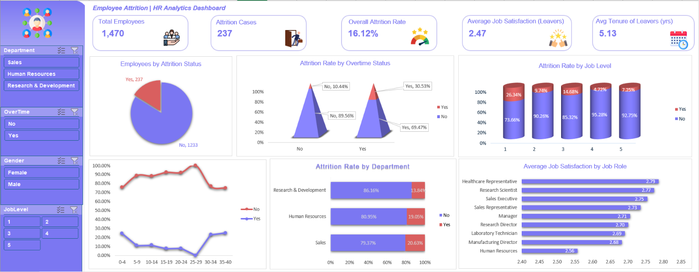

# HR Attrition Analysis (Excel)

Excel analysis of 1,470 employee records to find where attrition differs across employee groups, with an interactive slicer dashboard and a written report.

## Business problem
Adecco India has seen rising employee turnover, especially among junior-level staff. This project looks at which employee characteristics are associated with attrition and job satisfaction, and where management could investigate retention improvements.

## Key findings
- Overall attrition: **16.12%** (237 of 1,470 employees)
- **Overtime** shows the biggest gap: 30.53% attrition with overtime vs 10.44% without
- **Job level 1** has the highest attrition (26.34%), and levels 4 and 5 the lowest
- **Early tenure (0-4 years)** has the highest rate (24.31%) and the most leavers
- **Sales** has the highest department rate (20.63%), against 13.84% in Research and Development
- Leavers report lower job satisfaction: 2.47 vs 2.78 for those who stayed
- All numeric correlations with attrition are weak (largest: -0.171 for total working years)

## What I did
- Checked the data: no blanks, no duplicates, constant fields identified
- Built 13 pivot tables covering attrition, workforce, engagement and performance
- Calculated correlations between selected measures and an attrition flag
- Built a dashboard with 5 KPI cards, 6 charts and 4 slicers (Department, OverTime, Gender, JobLevel)

## Files
- `Adecco_HR_Analytics_Working.xlsx`: workbook (raw data, data checks, pivots, analysis, dashboard)
- `Adecco_HR_Analytics_Project_Report.pdf` / `.docx`: the full report
- `hr_dashboard.png`: dashboard preview

## Tools
Microsoft Excel: Tables, pivot tables and charts, slicers, formulas

## Limitations
Findings are descriptive associations, not causes. The data has no dates and no reason-for-leaving field, so it cannot show trends over time or explain why people left.

## Data source
IBM HR Employee Attrition case-study dataset, supplied with the DACS12 project brief. The data file is not redistributed here.

**Author:** Md Ziaul Haque
